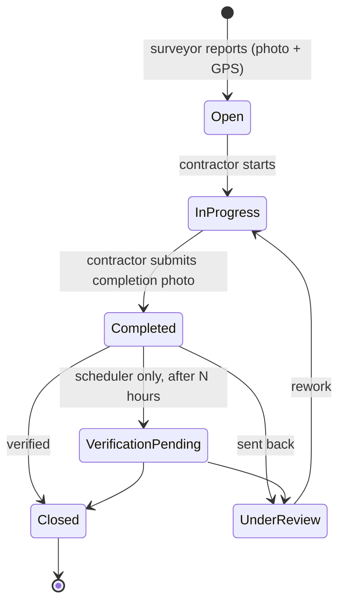
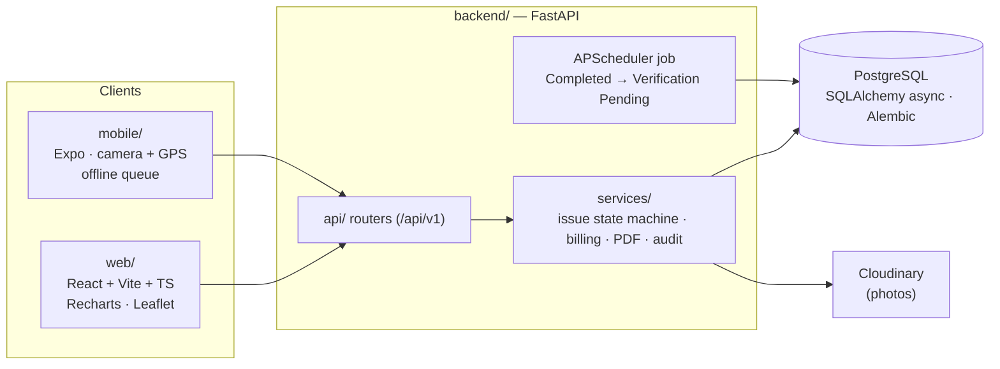

# RoadService

**Road-maintenance issue management for a highway operations contract.** Surveyors log defects from the field with camera photos and GPS, contractors fix them, admins verify and manage billing, and the government client gets a read-only view — all through one API shared by a web dashboard and a mobile app.

Built by [Afzal Surti](https://github.com/AfzalSurti) at Geo Designs & Research Pvt. Ltd.

`Python` · `FastAPI` · `async SQLAlchemy` · `Alembic` · `PostgreSQL` · `APScheduler` · `React + TypeScript` · `React Native (Expo)` · `Cloudinary`

---

## Why it's built this way

- **One source of truth.** All business rules live in FastAPI; the web and mobile clients are thin. Status changes go through a single transition map, so an invalid move (e.g. `Open → Closed`) is rejected by the API whatever client sends it.
- **System-only states.** `Verification Pending` can only be set by the scheduler — a background job moves issues that have sat in `Completed` past a configurable window (24 h by default).
- **Evidence by default.** Mobile capture is camera-only with GPS recorded at capture time, for the initial report, the completion and the verification.
- **Field connectivity.** The mobile app queues captures locally (AsyncStorage) when offline and syncs them later.

## Roles

| Role | Web | Mobile | Can do |
|---|---|---|---|
| Government | ✓ (read-only, enforced by the API) | — | Dashboards, reports |
| Admin | ✓ | — | Everything: projects, users, rates, billing approval, documents |
| Contractor | ✓ | ✓ | Start work, complete with photos, handle rework, raise bills |
| Surveyor | — (blocked at web login) | ✓ | Create and verify issues |

## Issue lifecycle



Source: `STATUS_TRANSITIONS` in [`backend/app/models/enums.py`](backend/app/models/enums.py), enforced by `ensure_transition` in [`backend/app/services/issue_service.py`](backend/app/services/issue_service.py).

## Modules

- **Issues** — defect catalogue from the client's defect sheets (`GET /api/v1/catalog/defects`), assignments, deadlines, photos, audit trail, map view.
- **Billing** — rates/BOQ, contractor bills with an approval chain (contractor → admin recommendation → government approval), invoice summaries.
- **Documents & approvals** — version history, check-in/check-out, approve/reject with a recorded signature line.
- **Field operations** — RFIs, queries, NCRs, site work, quantities, attendance and staff details.
- **Reporting** — analytics endpoints, PDF reports with embedded photos (ReportLab), Excel export (openpyxl), notifications.

The API has ~145 route handlers across 18 routers under `/api/v1`; interactive docs are served at `/docs`.

## Architecture



## Repository layout

```text
RoadService/
├── backend/
│   ├── app/
│   │   ├── api/          # routers: auth, issues, projects, billing, portal, rfis, analytics, ...
│   │   ├── models/       # SQLAlchemy models and enums
│   │   ├── services/     # issue_service (state machine), pdf_reports, invoice_summary, audit, storage
│   │   ├── jobs/         # verification scheduler job
│   │   ├── catalog/      # defect catalogue
│   │   ├── core/         # config, database, security
│   │   └── seed.py       # demo users and data
│   ├── alembic/          # 24 migrations
│   └── requirements.txt
├── web/                  # React (Vite + TypeScript) dashboards
├── mobile/               # Expo app for surveyors and contractors
├── PROJECT_SPEC.md       # roles, state machine, entities
└── render.yaml           # Render blueprint for the API
```

## Running locally

**Prerequisites:** Python 3.12, Node.js 18+, PostgreSQL (local or Neon), optionally a Cloudinary account for photo storage.

### 1. Environment

```bash
cp .env.example .env
```

Set at least `DATABASE_URL` (async, `postgresql+asyncpg://…`), `DATABASE_URL_SYNC` (`postgresql://…`, used by Alembic) and `SECRET_KEY`. Cloudinary variables are optional; without them uploads go to `UPLOAD_DIR`.

### 2. Backend

```bash
cd backend
python -m venv .venv
source .venv/bin/activate          # Windows: .venv\Scripts\activate
pip install -r requirements.txt
alembic upgrade head
python -m app.seed                 # one demo user per role — see backend/app/seed.py
uvicorn app.main:app --reload --port 8000
```

API docs: http://127.0.0.1:8000/docs · health check: `/health`

> The seed script creates demo accounts with known passwords. Use it only for local development, and never run it against a deployed database without changing those credentials.

### 3. Web

```bash
cd web
cp .env.example .env               # VITE_API_URL=http://127.0.0.1:8000
npm install
npm run dev                        # http://127.0.0.1:5173
```

### 4. Mobile (Expo)

```bash
cd mobile
cp .env.example .env               # on a phone, set EXPO_PUBLIC_API_URL to your LAN IP, e.g. http://192.168.1.10:8000
npm install
npx expo start
```

## Deployment

`render.yaml` deploys the API to Render (build runs `alembic upgrade head`; health check `/health`). The web app builds to static files for any static host; the mobile app is configured for EAS builds (`mobile/eas.json`).

## Known limitations

- No automated tests or CI yet; the state machine in `issue_service.py` is the first thing that should be covered.
- The scheduler runs inside the API process, so running multiple API instances would run the job more than once.

## Roadmap

- Unit tests for `ensure_transition` and billing totals, run in GitHub Actions.
- Push notifications for assignments and verification reminders.
- Real screenshots of the web dashboard and mobile app in this README.
